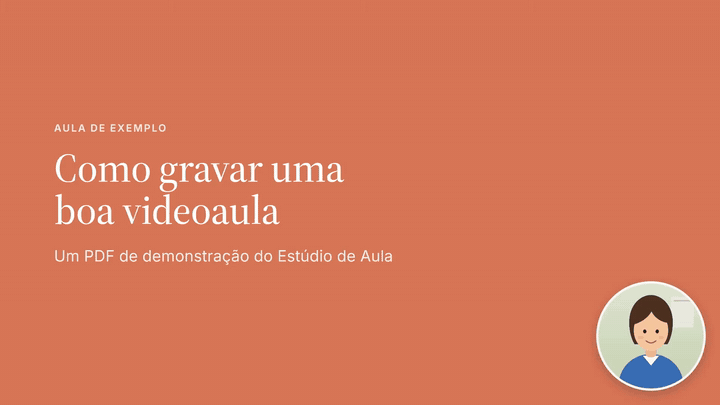
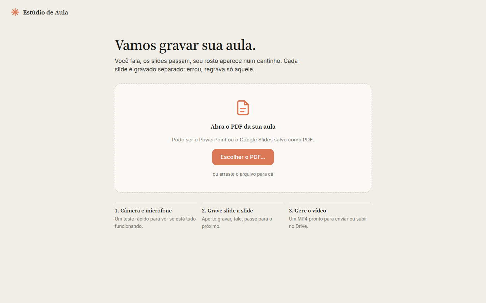
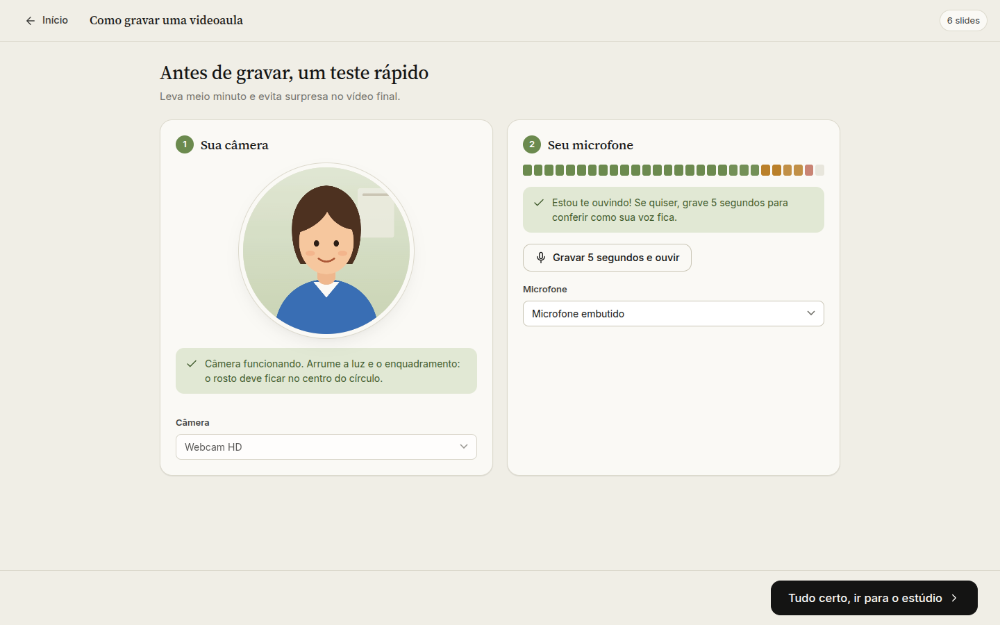
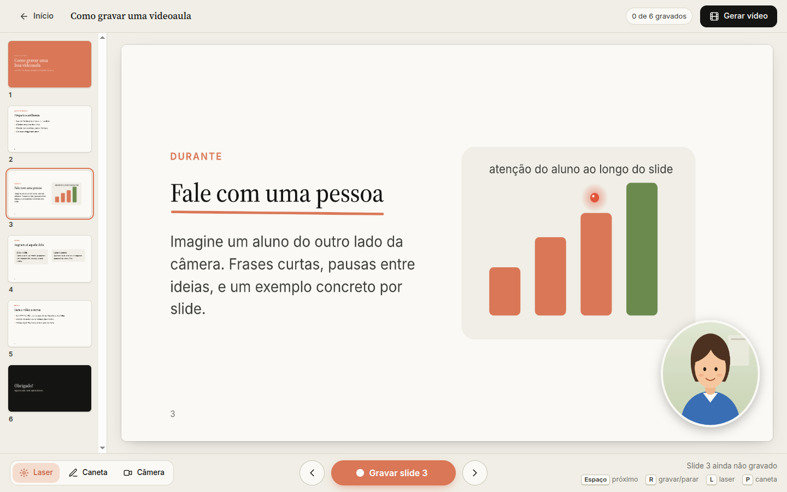
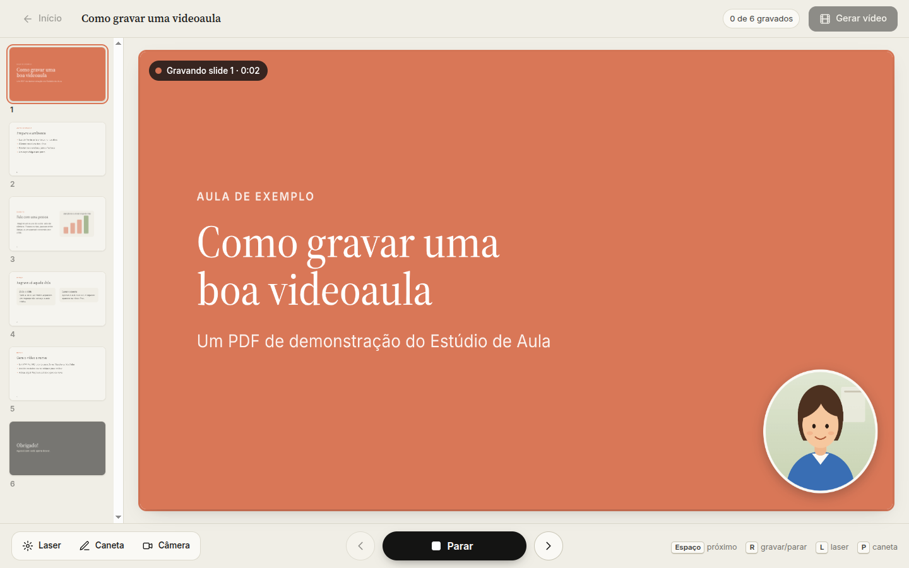

<div align="center">


# Estúdio de Aula

**Grave videoaulas a partir de um PDF no Linux: slides na tela, você narrando e seu rosto num cantinho.**

[](LICENSE)




<sub>Trecho de um vídeo gerado pelo app (com um avatar no lugar da câmera).</sub>

</div>

---

Gravar aula “estilo Loom” no Linux costuma dar trabalho: OBS para configurar, captura de tela
que fica preta no Wayland, câmera errada, áudio baixo. O **Estúdio de Aula** resolve isso de um
jeito simples, pensado para quem não é da área de tecnologia:

- 📄 **Você abre o PDF da aula** (exportado do PowerPoint, Google Slides, Keynote, Canva…).
- 🎙️ **Um teste rápido de câmera e microfone** antes de gravar, com mensagens claras quando algo dá errado.
- 🎬 **Grava slide a slide.** Aperte *Gravar* e vá passando com *Espaço*: para você é uma gravação
  contínua, mas cada slide é salvo separado. **Errou? Regrava só aquele slide.**
- 🔴 **Ponteiro laser e caneta** por cima do slide, que aparecem no vídeo.
- 🟠 **Câmera em círculo** num canto. Arraste para outro canto, mude o tamanho ou esconda em
  slides específicos.
- 🎞️ **Gera um MP4 Full HD** (H.264 + AAC, volume normalizado), pronto para Drive, Moodle,
  Classroom ou YouTube.

> **English:** a desktop app for Linux that records slide-by-slide video lessons from a PDF,
> with your webcam in a corner bubble, a laser pointer and a pen, exported as a 1080p MP4.
> It composes the video itself instead of screen-capturing, so it just works on Wayland.
> The interface is in Brazilian Portuguese.

## Por que funciona no Wayland

O app **não grava a tela**. Ele desenha o slide, a câmera, o laser e a caneta numa tela própria
de 1920×1080 e grava essa tela junto com o microfone. Então não há permissão de captura de tela,
nem tela preta, nem “qual janela você quer compartilhar?”. O que você vê no app é exatamente o
que sai no vídeo.

Outros cuidados:

- **Câmeras infravermelhas** (as do reconhecimento facial, que dão imagem preta) são ignoradas.
- **Microfone** com supressão de ruído e ganho automático.
- **Cada slide vai para o disco a cada segundo** enquanto você fala. Se o computador travar, é
  só abrir o mesmo PDF de novo e continuar de onde parou.
- O app avisa se o microfone ficar mudo ou se a câmera desconectar no meio da gravação.

## Instalação

Requisitos: Linux com GNOME (testado no Ubuntu 24.04, Wayland e X11), `git`, **Node.js 20+** e `npm`.

```bash
git clone https://github.com/dame9177/estudio-aula.git
cd estudio-aula
./scripts/install.sh
```

O instalador baixa as dependências (Electron, pdf.js e ffmpeg ficam dentro da pasta do projeto,
nada é instalado no sistema) e cria o atalho **Estúdio de Aula** no menu de aplicativos. Não
precisa de `sudo`.

Para remover o atalho: `./scripts/install.sh --remover`.

## Como usar

<table>
<tr>
<td width="50%"></td>
<td width="50%"></td>
</tr>
<tr>
<td><b>1. Abra o PDF.</b> Clique em <i>Escolher o PDF…</i>, arraste o arquivo para a janela
ou use o botão direito no PDF → <i>Abrir com → Estúdio de Aula</i>.</td>
<td><b>2. Teste rápido.</b> Confira o enquadramento e veja as barrinhas do microfone mexerem.
<i>Gravar 5 segundos e ouvir</i> mostra como sua voz vai ficar.</td>
</tr>
<tr>
<td></td>
<td></td>
</tr>
<tr>
<td><b>3. Prepare.</b> Laser (<kbd>L</kbd>), caneta (<kbd>P</kbd>) e o menu <i>Câmera</i>
(tamanho P/M/G, espelhar, esconder neste slide). Arraste a bolinha para o canto que preferir.</td>
<td><b>4. Grave.</b> <i>Gravar slide 1</i> → contagem 3-2-1 → fale → <kbd>Espaço</kbd> para o
próximo slide, sem parar. <kbd>Esc</kbd> pausa. Clique num slide e <i>Regravar</i> para refazer.</td>
</tr>
</table>

**5. Gere o vídeo.** Use *Gerar vídeo* → *Gerar vídeo (MP4)*. O arquivo fica em
`~/Vídeos/Estúdio de Aula/<nome da aula>/<nome da aula>.mp4`.

### Atalhos

| Tecla | O que faz |
|---|---|
| <kbd>Espaço</kbd> <kbd>→</kbd> <kbd>Page Down</kbd> | próximo slide (gravando: encerra este e já grava o próximo) |
| <kbd>←</kbd> <kbd>Page Up</kbd> | slide anterior |
| <kbd>R</kbd> | gravar / parar |
| <kbd>Esc</kbd> | parar a gravação |
| <kbd>L</kbd> / <kbd>P</kbd> | laser / caneta |
| <kbd>C</kbd> | mostrar/esconder a câmera neste slide |

Passadores de slide (*presenters*) que enviam Page Up/Down funcionam também.

### Se algo não funcionar

- **“Não consegui ligar a câmera”**: outro programa (Meet, Zoom, navegador) pode estar usando
  a câmera. Feche-o e clique em *Tentar de novo*.
- **As barrinhas do microfone não se mexem**: confira se o som não está mudo no canto da tela, ou
  escolha outro microfone na lista.
- **O app não abre pelo menu**: veja o log em `~/.local/state/estudio-aula/launch.log`.

## Desenvolvimento

```bash
npm install
npm start                 # roda o app
npm test                  # testes unitários (vitest), incluindo uma exportação real com ffmpeg
npm run e2e               # fluxo completo no Electron com câmera/microfone falsos (Playwright)
ESTUDIO_REAL_DEVICES=1 npx playwright test real-devices   # opcional: webcam e microfone reais
npx electron scripts/make-fixtures.js                    # regera o PDF de exemplo e o avatar
```

O e2e abre `tests/fixtures/Como gravar uma videoaula.pdf`, grava 3 slides (com troca
automática), regrava um, gera o MP4 e confere o resultado com `ffprobe`. As screenshots deste
README saem dele, em `test-results/shots/`.

**Como funciona por dentro:** Electron com pdf.js. O vídeo é montado num `<canvas>` de 1920×1080
(`canvas.captureStream`) e gravado com `MediaRecorder` em WebM VP9/Opus, um arquivo por slide.
O `ffmpeg` (via `ffmpeg-static`) junta os trechos, ajusta a duração de cada um nos dois fluxos
para o áudio não dessincronizar, normaliza o volume (`loudnorm`) e gera H.264/AAC. Mais detalhes
em [`docs/design.md`](docs/design.md) e [`AGENTS.md`](AGENTS.md).

Contribuições são bem-vindas: abra uma *issue* contando sua distro e o que aconteceu.

## Licença

[MIT](LICENSE). Fontes Inter e Source Serif 4 sob a SIL Open Font License. O ffmpeg embutido
(`ffmpeg-static`) é distribuído sob a GPL.
